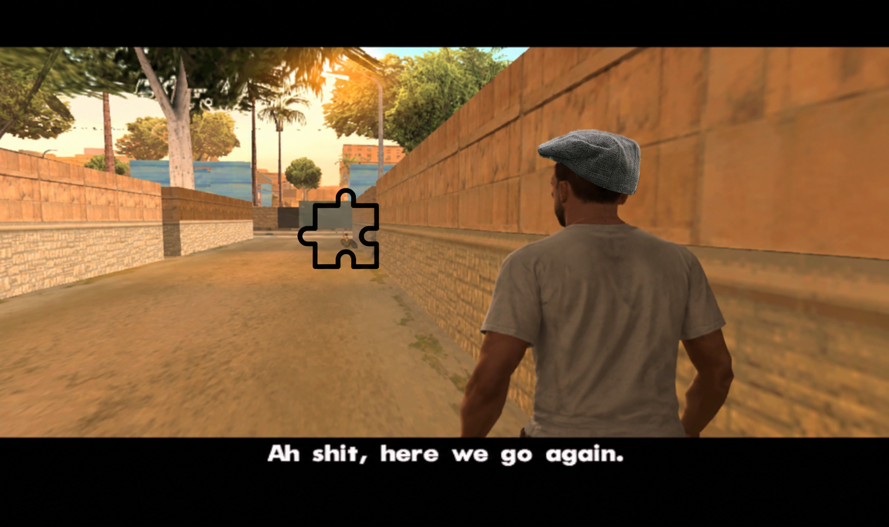

+++
title = 'Daily Challenge Tech'
date = 2026-10-19T15:12:03+01:00
authors = ["orta"]
tags = ["tech", "plugins", "api", "architecture"]
theme = "outlook-hayesy-beta"
+++


You can read [our blog post on the daily challenge here](/posts/2026/10/19/daily-challenge-release/). This is the technical deep dive on what it took to build the Daily Challenge.

To me, there is a core loop of Puzzmo:

- Go to the homepage
- Click a puzzle
- Complete the game
  - Go back to the homepage, go to a new puzzle
  - Take the recommendation to go to a new puzzle

People then just engage with this loop. Systems we introduce, basically need to be tying into this loop in some way. Things outside of 'opening the app, and playing a puzzle' basically need a way to neatly fit into that.

Zach's and my most ambitious version of the Daily Challenge basically involves hooking into a bunch of places on the loop and making them do something special when in the context of running the Daily Challenge. So, my first stab at this involved basically hooking into a lot of the core architecture of Puzzmo. An interesting ride through the past but also, like, I'm doing a real set of cross cutting concerns.  

## API Side

I still tend to build these things out with the API design first, so I make a [high-level proposal GitHub issue](./issue-5485.png) to give others a chance to influence the architecture before I start. After a few days I take a stab at implementing the systems, then once that's got a shape I take a stab at the user interface.

I thought back to my time at [Artsy](https://github.com/artsy/artsy-event_publisher), one of the scaling solutions we used for allowing microservices was switching to an [event source](https://martinfowler.com/eaaDev/EventSourcing.html) architecture using rabbitmq. I enjoy the conceptual idea of splitting into microservices but want nothing to do with the actual implementation of it. So, my first stab at this was an in-memory event sourcing system. I went down this rabbit hole for a few days and came out thinking, maybe this could work and before committing to the idea, I took a break to work on something else.

Now, I'm a proper _'everything is a plugin'_ guy, I've solved so many problems in Puzzmo with plugins. ([1](https://blog.puzzmo.com/posts/2024/03/28/an-ode-to-game-plugins/), [2](https://blog.puzzmo.com/posts/2024/04/17/v1-launch/), [3](https://blog.puzzmo.com/posts/2024/07/16/augmentations/), [4](https://blog.puzzmo.com/posts/2024/09/19/plugins-are-back-in-style/), [5](https://blog.puzzmo.com/posts/2024/10/30/tech-stack/), [6](https://blog.puzzmo.com/posts/2025/01/22/turborepo/), [7](https://blog.puzzmo.com/posts/2025/06/08/offline-wip/), [8](https://blog.puzzmo.com/posts/2025/12/9/tech-2025/), [9](https://blog.puzzmo.com/posts/2026/01/06/look-ma-no-code/).) So, you'd think I'd be pretty done on plugins! Guess what! Nope. After thinking about the whole system from scratch, I wondered that maybe we just need another plugin API.

It turned out that I had architected something like this before: Back during the [launch of Pile-up Poker](/posts/2024/09/19/plugins-are-back-in-style/#event-plugins) `EventPlugin`. So, to re-use my last meme.



The `EventPlugin` was a solid abstraction, but flawed in that doing smaller events for game launches on Puzzmo just wasn't worth our time on the long run. So, an event plugin looked like this:

```ts
type EventPlugin = {
  name

  // Completion screen
  addCalloutsToSidebar(gameplay)          -> callouts     // e.g. the PUP ticker
  extendSidebarItemArray(items, gameplay) -> items

  // Leaderboards
  todayPageLeaderboardStableIDs         -> ids
  puzzleLeaderboardStableIDs(puzzle)    -> ids
  extraLeaderboardsForUser(user, daily | puzzle) -> leaderboards

  // Augmentation scopes
  extendAggregateUserEvalScope(scope)
  extendDailyEvalScope(scope, daily)
  extendGameEvalScope(scope, gameplay)

  // Pipelines
  gameplayCompletePrePipeline(gameplay, deeds)
  gameplayCompletePipelineUpdateGroups(groups, gameplay, user)
  codeWasAccepted(batch)
  hourlyWork(hour, daily)
}

```

The abstraction had basically been abandoned at this point, but it hooks into places like leaderboards, completion screens and was able to hook into a few pipeline moments for the lifecycle of that core loop. However, implementation wise a lot of it is tied to a temporary event timeline.

I wanted to make something more substantial which could both handle more cases, but also give me the chance to go back through the set of cross-cutting features we have in Puzzmo today and re-build them using this plugin API.

With that goal in mind I sketched out what I'd like to see:

- Feature flags as a native concept
- User creation, subscription, deletion hooks
- Cron system hooks
- All known gameplay hooks, starting, midway, completion (everyone) and post-completion (users) hooks

I figured a way to frame this is that it is a 'site feature' and so `FeaturePlugin`s were made:

```ts
type FeaturePlugin = {
  name
  flag?                                  // role, or { role, gates: "everything" | "reads", partnerEnables }
  isEnabled?(env)        -> bool         // for things a flag can't express (env vars, dates)

  // Users
  userCreated?(user, wantsEmail)
  anonPlaysMigrated?(userID, anonOwnerID)
  userDeleted?(user, accountIDs)
  subscriptionChanged?(from, to, source)  // stripe | revenuecat | lifetime | admin

  // Gameplay
  gameplayStarted?(gameplay)
  gameplayCheckpoint?(gameplay, deeds)  -> { tutorialCompletedItems }
  gameplayCompleted?(gameplay, deeds, userState, playContext)
  gameplayPostCompletion?(gameplay, user, augmentations, eligibility)

  // Completion screen
  completionRecommendations?(gameplay, routeContext) -> recs | "skip"
  completionSidebarItems?(gameplay, deeds, leaderboards) -> items

  // Cron
  cron?: [{ name, hour | "every", run(daily) }]
}
```

This plugin space covers a tonne of older systems, here's a simplified version of the feature of 'send a notification if you play a game for the first time to your followers'

```ts
/** Tells a player's followers the first time they play a game from Today */
export const firstPlayNotificationPlugin: FeaturePlugin = {
  name: "first-play-notification",

  gameplayPostCompletion: async ({ user, userState, gameplay, puzzleDaily }) => {
    const game = gameplay.puzzle.game

    // Skip unreleased or role-gated games, so we don't leak them to followers
    if (isHiddenFromPublic(game, puzzleDaily?.onlyRoles)) return

    // The streak total was bumped at completion, so 1 means this was the first
    const streak = getStreak(userState)[game.slug]
    if (streak?.total !== 1) return

    await notifyFollowers(user.id, `played ${game.displayName} for the first time`)
  },
}
```

I used `CLAUDE.md` files in these plugins to keep a 'product manager' level of the feature in sync with a human readable version for others.

````md
# First Play Notification

A product-level overview of the "played X for the first time" notification. `firstPlayNotificationPlugin.ts` is the entry point, and `createFirstTimePlayNotification` in `src/lib/notifications/notifications.ts` does the work.

**Keep this doc in sync with the code.** If you change when the notification is sent or who gets it, update this file in the same change.

## What it is

When a signed-in player finishes a game for the first time, everyone who follows them gets a social notification: "<player> played <game> for the first time".

## When it's sent

- **First time:** "first" means the player's streak for that game has a total of exactly 1. Streaks only count puzzles on that day's Today page, so it's the first Today play of the game, not the first ever play. Remixes with their own streak count as their own game.
- **Public games only:** it's skipped for games that aren't public yet and for puzzles limited to certain roles, so nothing leaks before launch.
- **Signed in only:** it runs after completion for accounts, so signed-out plays don't send one.

## Rollout

The first play notification is a feature plugin (see the Feature Plugins section in the API [CLAUDE.md](../../../CLAUDE.md)) using `gameplayPostCompletion`. It has no feature flag.
````

This is maintained by a reference in our root `CLAUDE.md` which looks like this:

````md
## Feature Plugins

Cross-cutting features (ones that react to lifecycle moments across every game, like the Daily Challenge) are built as feature plugins in [src/lib/featurePlugins/](src/lib/featurePlugins/), not hard-coded into the lifecycle files. The design is in [#5485](https://github.com/puzzmo-com/app/issues/5485), and [src/lib/dailyChallenge/dailyChallengePlugin.ts](src/lib/dailyChallenge/dailyChallengePlugin.ts) is the reference plugin. Smaller examples are [Game Center](src/lib/gameCenter/gameCenterPlugin.ts), the [champions league](src/lib/championsLeague/championsLeaguePlugin.ts) (a read hook plus cron) and the [create first time notification](src/lib/createFirstTimePlayNotification/createFirstTimePlayNotification.ts).

- When a new feature needs to run at user creation, sign-in migration, deletion, a subscription change, gameplay start, checkpoint or completion, post-completion, in the completion recommendations or sidebar, or on the hourly cron, make it a `FeaturePlugin` and add it to the `featurePlugins` list rather than editing `gameCompleted.ts`, `postGameCompletion.ts`, `postUserCreate.ts`, `scripts/Hourly.ts` and friends
- Gate it with `flag` (a user feature flag) rather than checking roles inside hooks; use `gates: "reads"` when writes should count before the UI ships
- Hooks get everything through their event and `HookEnv` (subject, viewer, partner, today's daily); don't read the ambient `context` inside a hook
- Give each plugin its own `src/lib/<feature>/` folder holding the plugin, its lib code and a product-level `CLAUDE.md` (see [src/lib/dailyChallenge/CLAUDE.md](src/lib/dailyChallenge/CLAUDE.md)), and keep that doc in sync when the plugin changes
- If the moment you need has no hook yet, add the hook to the plugin API instead of hard-coding the feature into the call site
- When a hook needs to hand something back to its call site, add it to `LifecycleHookResults` (see the [tutorial plugin](src/lib/tutorial/tutorialPlugin.ts)); expensive event fields go behind `memoizeOnce` so they're only built when a plugin asks
- When working in or near an existing ad-hoc feature that fits this shape (clubs, per-game streaks, the event plugins, etc.), offer to refactor it into a feature plugin, but don't do it unprompted
````

I had Claude go pretty wild on the implementation for the API side, with some pretty interesting type generics etc but that's pretty easy for someone to just whip up easily at this point. You can sort of get the sense of the original event source system in the API use though:

```ts
await runFeatureHook(
  "gameplayPostCompletion",
  { gameplay, user, userState, puzzleDaily, augmentations, deeds,
    eligibility: { isPaid, isCheater, isContributor, alwaysDoLeaderboards } },
  { subject: { id: user.id } },
)
```

```ts
const { tutorialCompletedItems } = await runFeatureHook(
  "gameplayCheckpoint",
  { gameplay, checkpointName, deeds, deedScope: memoizeOnce(() => getScopeFromDeedsForGame(deeds, gameplay)) },
  { subject: { id: ownerID } },
)
```

```ts
await runFeatureHook("userCreated", { user, userState, wantsEmail }, { subject: { id: userID, user } })
```

```ts
return withSubscriptionChange(accountID, "lifetime", () =>
  db.account.update({ where: { id: accountID }, data: { lifetimePro: true, lifetimeProAt: new Date() } }),
)
```

## Front End

When I think about the front-end for Daily Challenge, a lot of it came together quite organically. I've been away from doing chunky work on puzzmo.com for a few years at this point, and since then there's been a few shots at making design systems and two re-designs.

So, it was quite pleasant to come back armed with Claude as a collaborator, able to make pretty sweeping design changes in a way that lets me think in systems but have something do a lot of the pedantic pixel pushing.

I don't like aiming for pixel perfect designs. I am glad there are people who do but to me it's a tedium that we just have to put up with just a part of building public-facing software. Building and collaborating on front-end projects  with others in this space also tends towards the most mundane, un-interesting feedback like "dark mode on mobile chrome needs this colour tweaking", or "this element is cropped on desktop firefox." - it's like the worst part of the whole process to me.

This is exacerbated when you ship the thing, I find you generally ship to relative silence but the vast majority of the feedback for any product launch is feedback like the above. I've just grown to have a mentality of _'all feedback is a gift'_ but at heart it's just not interesting feedback and it takes the space of actual interesting conversation about the thing itself.

So, having Claude Code handle a lot of the faff here has been such a win and I'm pretty pumped to be working on Puzzmo's front-end again.

I cut my teeth getting used to the modern puzzmo.com codebase by cleaning up the settings pages, and taking the theme editor out of beta (it now includes a 'generate a theme from an image' which I've been enjoying.)

We based the shape of the Daily Challenge on some figma mockups from Zach. I don't think Claude Design is great at our design system: it's great for trend-oriented design, but the two of us have a minimalist design aesthetic which doesn't really pin to this particular era. So, when I have played with it, it arcs towards a design which doesn't quite feel natural with the rest of the website.

Honestly, there's not much to say about the front-end work which went into the Daily Challenge. It is mundane React/Relay/StyleX, I'm happy with a lot of the animation polish I added and I do think working with Claude on the front-end makes the work a lot closer to simply doing design work and then product level testing instead of devoting painstaking hours on annoying finicky front-end code.

## Wrapping up

Coming back to that core loop: the Daily Challenge is really just the loop made explicit. Pick a game, finish it, get handed the next one. The interesting work wasn't the widget, it was making it possible to hook into every step of the loop without hard-coding a new feature into `gameCompleted.ts` for the nth time.

The nice side-effect is that the plugin API is a big win. We've moved 11 older systems (Game Center, the champions league, bluesky/atproto support, tutorials etc…) over to feature plugins, each with its own folder and a `CLAUDE.md` describing what it does. The next cross-cutting idea we have is a new folder, not surgery on the lifecycle code.

So, I'm still here betting on plugins, even in a post-Claude Code world.
